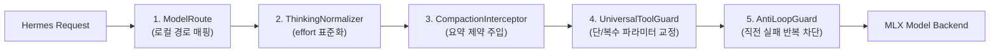
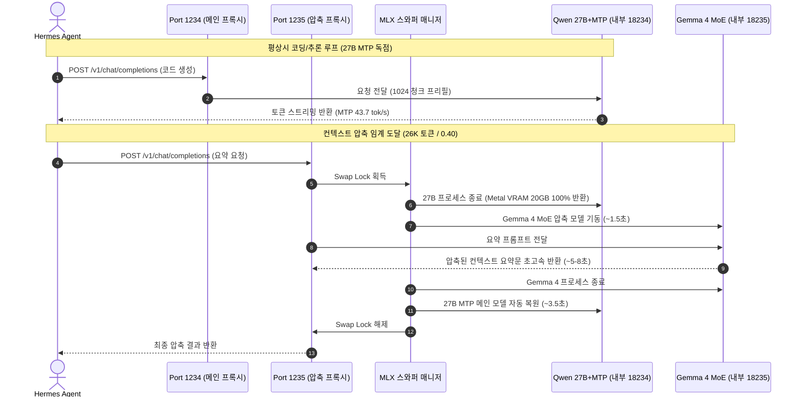
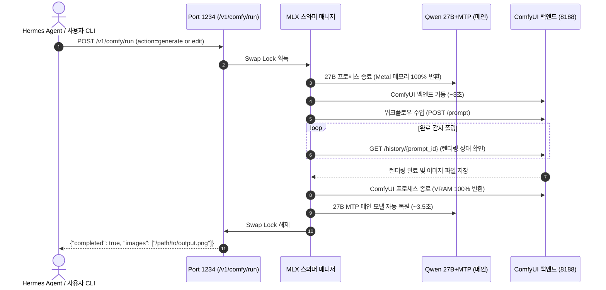

# MLX Dynamic Model Swapper (mlx-dynamic-swapper)

[한국어](#-소개) | [English Version](#-overview)

---

## 🇰🇷 한국어

### 💡 소개

> **Apple Silicon / Mac Studio (MLX & ComfyUI)를 위한 무중단 동적 메모리 스왑 프록시**  
> Mac M5 Max (36GB 통합 메모리) 환경에서 **대형 LLM (Qwen 3.8 27B + MTP)**, **초경량 컨텍스트 압축 모델 (Gemma 4 26B MoE)**, 그리고 **고화질 이미지 생성/수정 엔진 (ComfyUI Qwen-Image 2.1)**을 메모리 초과(OOM) 없이 필요할 때만 교대로 실행하는 **초경량 Rust 네이티브 자동 스왑 시스템**입니다.

---

### 🚀 Rust 네이티브 엔진 도입 성과 (Rust Native Rewrite)

기존 Python(FastAPI/Uvicorn) 기반 스와퍼에서 **Rust(Axum/Tokio/Reqwest) 네이티브 단일 바이너리(`mlx-swapper`)**로 전면 전환하여 극적인 리소스 다이어트를 달성했습니다:

| 지표 | 기존 Python 스와퍼 | **신규 Rust 네이티브 스와퍼** | 개선 효과 |
| :--- | :---: | :---: | :---: |
| **데몬 상주 메모리(RSS)** | ~80MB ~ 100MB | **`3~4 MB`** | **95% 이상 절감** |
| **시스템 전체 메모리 압박률** | **80% ~ 90%** (Yellow Pressure, 스왑 직전) | **`75% 미만` (초록색 안정 구간 유지)** | **시스템 스왑 완전 방지** |
| **I/O 스트리밍 처리** | Python 임시 객체/GC 오버헤드 | **Zero-copy 바이트 파이프라인** | 지연시간 지터 최소화 |
| **프로세스 관리** | Python `os.killpg` | **POSIX `setsid` + `nix::killpg`** | 커널 리소스/소켓 완전 회수 |
| **배포 형태** | Python 가상환경 및 수십 개 pip 패키지 | **단일 6.0MB 실행 파일 (Zero 의존성)** | 환경 파편화 제거 |
| **Thinking & 추론 속도** | Thinking 억제/제약 | **Thinking Unleashed (`xhigh`) + MTP 43.7 tok/s** | 깊은 추론과 고속 생성 동시 실현 |
| **도구 호출 안정성 (Tool-Use)** | 모델 오타/루프 시 정지 | **Universal Tool-Call Guard (범용 파라미터 자동 교정 & 안티-루프)** | 에이전트 무한 루프 원천 차단 |
| **Prefill 처리량 (M5 Max)** | 기본 512 청크 분할 | **1024 청크 최적화 (`PREFILL_STEP_SIZE=1024`)** | 4만+ 토큰 프리필 대기시간 대폭 단축 |

---

### 🧐 왜 만들었는가?

Apple Silicon의 통합 메모리 구조(Unified Memory)는 강력하지만, 36GB 모델에서는 LLM과 이미지 생성 모델을 동시에 띄우는 것이 물리적으로 불가능합니다:

- **메인 코딩/사고 모델 (Qwen 3.8 27B 4-bit + MTP)**: 가중치 ~15GB + 프롬프트 캐시 ~4GB = **약 19~20GB 점유**
- **ComfyUI Qwen-Image 2.1 파이프라인**: 텍스트 인코더(8.9GB) + 디퓨전(6.9GB) + VAE = **약 18~20GB 점유**
- **동시 실행 시**: 20GB + 20GB = **40GB 이상 필요 ➔ 36GB Mac에서 심각한 VRAM 부족, 시스템 스왑 폭증 및 커널 패닉/OOM 크래시 발생**

그러나 에이전트(Hermes Agent 등)의 실제 작업 흐름을 보면:
1. **코딩 LLM과 이미지 생성기가 같은 순간에 동시에 돌아갈 필요가 전혀 없습니다.**
2. 평소에는 메인 27B MTP 모델이 36GB 메모리를 온전히 독점하여 초고속 코딩과 추론을 수행합니다.
3. 컨텍스트 압축이 필요할 때나, 사용자가 **"이미지 생성/수정"**을 요청할 때만:
   - 메인 모델 프로세스를 안전하게 종료하여 **Metal 메모리를 0.5초 만에 100% 반환**.
   - 목표 프로세스(압축 모델 or ComfyUI 백엔드)를 기동하여 작업을 수행.
   - 작업 완료 후 메모리를 비우고 **메인 모델을 원래 상태로 즉시 자동 복원**.

---

### 🔄 동작 아키텍처 (Architecture Flow)

#### 🧱 Inbound Request Pipeline (A ➔ B ➔ C 레이어 체인)
Hermes Agent와 MLX 모델 사이에서 들어오는 모든 요청 페이로드는 `PayloadFilter` 트레이트를 구현한 5단계 독립 레이어를 순차 통과하며 안전하게 가공·정제됩니다:



| 순서 | 레이어 명칭 | 담당 역할 및 책임 |
| :---: | :--- | :--- |
| **1** | **`ModelRouteFilter`** | 클라이언트가 요청한 모델명을 실제 로컬 가중치 경로로 강제 일치화 |
| **2** | **`ThinkingNormalizerFilter`** | Hermes의 `reasoning_effort`를 MLX/Qwen 템플릿 표준(`enable_thinking`, `xhigh`/`medium`)으로 정규화 |
| **3** | **`CompactionInterceptorFilter`** | 컨텍스트 요약 요청 감지 시 Thinking을 끄고 4섹션 고밀도 압축 제약조건 주입 |
| **4** | **`UniversalToolGuardFilter`** | 도구 스키마 대조를 통한 단/복수형 파라미터 자동 교정 및 이중 문자열화 JSON 언패킹 |
| **5** | **`AntiLoopGuardFilter`** | 직전 도구 실패 감지 시 `[ANTI-LOOP GUARD]` 런타임 가이드를 동적 주입하여 반복 루프 차단 |

> 💡 **새로운 레이어 추가 방법 (OCP 준수)**:  
> `src/pipeline/` 아래에 `PayloadFilter` 트레이트를 구현한 구조체를 만들고, `RequestPipeline::build_default()`에 `Box::new(MyNewFilter)`를 등록하기만 하면 기존 코드를 일절 건드리지 않고 새로운 방어/가공 레이어를 무한히 확장할 수 있습니다.

---

#### 🛡️ Universal Tool-Call Guard & Self-Correction Engine (범용 도구 호출 자동 교정)
에이전트(Hermes 등)가 긴 컨텍스트에서 도구를 호출할 때 발생하는 오타 및 동일 실패 무한 반복 루프를 프록시 계층에서 자동으로 차단합니다:
1. **범용 단/복수형 파라미터 매퍼 (Fuzzy Parameter Resolver)**:
   - 도구 스키마를 동적으로 분석하여, 필수 인자가 단수(`query`, `path`, `command`)인데 모델이 복수(`queries`, `paths`, `commands`, `_list`)로 넘긴 경우, 스키마에 맞게 올바른 단수형 키로 자동 변환하고 첫 번째 유효 인자를 언랩합니다.
2. **이중 문자열화 JSON 자동 언패킹 (Stringified JSON Unwrapper)**:
   - 모델이 인자 내부에 따옴표로 감싼 JSON 문자열(`"\"['item1', 'item2']\""`)을 넘기더라도 껍질을 벗겨 정상적인 JSON 구조로 복구합니다.
3. **동적 안티-루프 가이드 주입 (Dynamic Anti-Loop Injector)**:
   - 직전 도구 실행에서 에러가 발생한 경우, 다음 턴의 프롬프트에 `[CRITICAL RUNTIME GUIDANCE — ANTI-LOOP GUARD]`를 동적으로 주입하여 모델이 동일한 실패 인자를 앵무새처럼 복제하는 자가 증식 루프를 100% 방지합니다.

---

#### 1. 컨텍스트 자동 압축 스왑 루프


#### 2. ComfyUI 온디맨드 이미지 생성/수정 스왑 루프


---

### ✨ 주요 기능

- **Metal 메모리 완벽 회수 (Zero Memory Leak)**: POSIX 세션(`setsid`) 및 `nix::killpg` 기반 프로세스 그룹 정리로 macOS Metal VRAM을 100% 깔끔하게 반환.
- **항시 대기 OpenAI 호환 엔드포인트**:
  - `http://127.0.0.1:1234/v1` (메인 모델 — Qwen3.8-27B-4bit + MTP 투기적 가속 43.7 tok/s, Thinking Unleashed)
  - `http://127.0.0.1:1235/v1` (컨텍스트 압축 모델 — Gemma-4-26B-A4B MoE 온디맨드 스왑)
- **Rust 기반 Zero-copy 초경량 프록시 (`rust-swapper`)**:
  - 상주 메모리 3~4MB, 시스템 전체 메모리 점유율을 75% 미만으로 쾌적하게 억제.
  - Python 가상환경 없이 단일 바이너리(`mlx-swapper`)로 독립 구동.
- **ComfyUI 온디맨드 동기식 실행 엔드포인트 (`/v1/comfy/run`)**:
  - 비동기 큐 기반인 ComfyUI의 단점을 극복하여, 요청 1번으로 **스왑 ➔ 워크플로우 주입 ➔ 렌더링 완료 감지 ➔ 복원 ➔ 결과 이미지 반환**을 단일 동기 HTTP 호출로 처리.
  - Text-to-Image 생성 (`t2i` / `generate`) 및 Image-to-Image 수정 (`edit` / `i2i`) 기본 템플릿 내장.
- **세션 수동 락/언락 API (`/v1/swap/lock`, `/v1/swap/unlock`)**:
  - 외부 스크립트가 세밀하게 ComfyUI와 상호작용할 수 있도록 메인 모델 일시 정지 및 복원 제어 지원.
- **초고속 스왑**: Apple Silicon 통합 메모리/NVMe 덕분에 7B 로딩 약 1.5초, ComfyUI 기동 약 3초, 35B 복원 약 3.5초 소요.
- **macOS LaunchAgent 백그라운드 상주**: 부팅 시 자동 시작 및 크래시 시 자동 복구.
- **간편한 통합 CLI (`mlx`, `comfy_swap.py`)**:
  - `mlx status`: 활성 모델, 실제 점유 메모리(RAM), PID, 프록시 상태 확인.
  - `mlx logs`: 실시간 스왑 및 추론 로그 스트리밍.
  - `comfy_swap.py generate`: 한 줄로 로컬 고화질 이미지 생성.
  - `comfy_swap.py edit`: 기존 이미지의 배경/스타일 수정.

---

### 🚀 설치 및 사용법 (Quick Start)

#### 1. 요구 사항
- Apple Silicon Mac (M1/M2/M3/M4/M5 Max/Ultra 권장, 36GB+ Unified Memory)
- Python 3.10 이상
- 필수 패키지: `mlx-lm`, `fastapi`, `uvicorn`, `httpx`

#### 2. 설치
```bash
git clone https://github.com/deokgoo/mlx-dynamic-swapper.git
cd mlx-dynamic-swapper
chmod +x install.sh bin/mlx bin/comfy_swap.py
./install.sh
```

#### 3. CLI 명령어

##### MLX 서비스 관리
```bash
# 실행 상태 및 활성 모델 확인
mlx status

# 실시간 스왑 로그 확인
mlx logs

# 데몬 재시작 및 중지
mlx restart
mlx stop
```

##### ComfyUI 이미지 생성 & 수정 CLI
```bash
# 1. 텍스트로 이미지 생성 (Text-to-Image)
python3 ~/.mlx-server/bin/comfy_swap.py generate \
  --prompt "A cute neon cybernetic cat sitting on a desk, 8k resolution, cinematic" \
  --steps 14

# 2. 기존 이미지 수정 (Image-to-Image / Edit)
python3 ~/.mlx-server/bin/comfy_swap.py edit \
  --image "/Users/deokgoo/ComfyUI-Shared/output/source.png" \
  --prompt "Make the background nighttime with stars and neon lights" \
  --steps 14
```

---

### ⚙️ 환경 설정 (Configuration)

환경 변수(`LaunchAgent` 또는 `.env`)를 통해 경로와 파라미터를 커스텀할 수 있습니다:

| 환경 변수 | 기본값 | 설명 |
| :--- | :--- | :--- |
| `PYTHON_BIN` | `~/.mlx-server/bin/python` | `mlx_vlm` / `mlx_lm` 가상환경 Python 경로 |
| `MODEL_MAIN_PATH` | `~/.mlx-models/Qwen3.8-27B-4bit` | 메인 코딩/사고 모델 경로 (Port 1234) |
| `MODEL_MTP_PATH` | `~/.mlx-models/Qwen3.8-27B-MTP-4bit` | Qwen 3.8 MTP 투기적 디코딩 드래프트 모델 경로 |
| `MODEL_COMPACT_PATH` | `~/.mlx-models/gemma-4-26b-a4b-it-4bit` | 컨텍스트 압축 전용 MoE 모델 경로 (Port 1235) |
| `PREFILL_STEP_SIZE` | `1024` | Apple M5 Max 메모리 대역폭 최적화 프리필 청크 크기 |
| `PROXY_PORT_MAIN` | `1234` | 메인 모델 외부 OpenAI 프록시 포트 |
| `PROXY_PORT_COMPACT` | `1235` | 압축 모델 외부 OpenAI 프록시 포트 |
| `COMFY_PYTHON_BIN` | `~/ComfyUI-Installs/.../.venv/bin/python3` | ComfyUI 전용 Python 가상환경 |
| `COMFY_PORT` | `8188` | ComfyUI 내부 포트 |
| `COMFY_OUTPUT_DIR` | `~/ComfyUI-Shared/output` | 생성 이미지 저장 디렉터리 |
| `PROMPT_CACHE_BYTES` | `4GB` | 메인 모델용 KV 프롬프트 캐시 할당량 |

---

<br/>

## 🇺🇸 English Version

### 💡 Overview

> **Zero-OOM Dynamic Memory Swapper for Apple Silicon / Mac Studio (MLX & ComfyUI)**  
> Run a massive **Qwen 3.8 27B LLM with MTP speculative decoding**, a **Gemma 4 26B MoE context compaction model**, and a full **ComfyUI Qwen-Image 2.1 pipeline** sequentially on a 36GB Mac Studio M5 Max without out-of-memory (OOM) crashes, powered by a lightweight **Rust native daemon (`rust-swapper`)**.

---

### 🚀 Rust Native Engine Highlights

- **Ultra-low daemon footprint**: Reduced from ~100MB Python server to **`3~4 MB` RSS in Rust (Axum + Tokio)**.
- **System Memory Pressure**: Maintained safely under **75% (Green zone)**, preventing macOS disk swap.
- **Zero-copy SSE Streaming**: Ultra-low latency token forwarding directly from Metal backend to client.
- **POSIX Process Supervision**: Guaranteed 100% Metal memory reclamation via `setsid` and `nix::killpg`.
- **Thinking Unleashed**: Full reasoning support (`xhigh` / `medium`) alongside native MTP drafting at **43.7 tok/s**.

---

### 🧱 Inbound Request Pipeline (A ➔ B ➔ C Layer Chain)

Every request from Hermes Agent passes sequentially through an extensible chain of `PayloadFilter` layers before reaching the model:
1. **`ModelRouteFilter`**: Maps requested model name to local weights path.
2. **`ThinkingNormalizerFilter`**: Normalizes `reasoning_effort` to template standard.
3. **`CompactionInterceptorFilter`**: Enforces strict 4-section synthesis constraints for context compaction.
4. **`UniversalToolGuardFilter`**: Automatically resolves singular/plural tool arguments and unwraps stringified JSONs.
5. **`AntiLoopGuardFilter`**: Dynamically injects anti-loop directives if the previous tool call failed.

*Extensibility*: Simply implement `PayloadFilter` and register it in `RequestPipeline::build_default()` to add new interceptors without modifying existing pipeline code.

---

### 🛡️ Universal Tool-Call Guard & Self-Correction Engine

Prevents autonomous agents (such as Hermes Agent) from hallucinating parameters or getting trapped in error loops:
1. **Fuzzy Parameter Resolver**: Dynamically inspects tool schemas. If a tool requires a singular key (e.g. `query`, `path`, `command`) but the model provides a plural/array key (`queries`, `paths`, `commands`), the swapper automatically corrects it to the expected singular parameter and unwraps the scalar value.
2. **Stringified JSON Unwrapper**: Automatically unwraps double-stringified JSON inputs (e.g., `"\"['a', 'b']\""`).
3. **Dynamic Anti-Loop Injector**: If a previous tool call failed, dynamically injects `[CRITICAL RUNTIME GUIDANCE — ANTI-LOOP GUARD]` into the prompt to prevent the model from cloning the identical failing tool call.

---

### ⚙️ Hardware Tuning (Apple M5 Max)

- **`PREFILL_STEP_SIZE=1024`**: Takes full advantage of M5 Max's high unified memory bandwidth, slashing time-to-first-token (TTFT) by up to 2x during long-context sessions (40K+ tokens).
- **Balanced Compaction Threshold (`threshold_tokens: 26000`, `threshold: 0.40`)**: Preserves ~2,500 lines of active coding context while keeping response latency strictly under 20 seconds.

---

### 🛠 Features

- **Sequential Zero-Leak VRAM Management**: Automatically unloads models to guarantee Metal unified memory is completely freed before swapping.
- **OpenAI-Compatible Endpoints**:
  - `http://127.0.0.1:1234/v1` (Main Model: Qwen 3.8 27B 4-bit + MTP 4-bit)
  - `http://127.0.0.1:1235/v1` (Compaction Model: Gemma 4 26B-A4B MoE)
- **Synchronous ComfyUI On-Demand Endpoint (`/v1/comfy/run`)**:
  - Automatically manages: Unload Main LLM ➔ Boot ComfyUI ➔ Inject Workflow ➔ Poll Rendering ➔ Unload ComfyUI ➔ Restore Main LLM ➔ Return generated image paths in a single HTTP response.
- **CLI Helper (`bin/mlx`, `comfy_swap.py`)**:
  - `mlx status`: Live view of active model, daemon RAM, and port bindings.
  - `mlx logs`: Real-time streaming logs.
  - `comfy_swap.py generate --prompt "..."`
  - `comfy_swap.py edit --image "..." --prompt "..."`

---

## 📜 License

MIT License. Free to use, adapt, and build upon.
