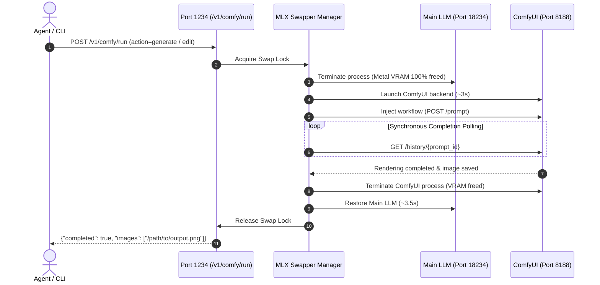

# MLX Dynamic Model Swapper (`mlx-dynamic-swapper`)

[](LICENSE)
[]()
[-brightgreen.svg)]()
[]()

> **Zero-OOM Dynamic Memory Swapper & AI Agent Gateway for Apple Silicon**  
> Run massive **MLX LLMs (DeepSeek-R1 / Qwen 27B+MTP)**, **Context Compaction Models**, and **ComfyUI Image Pipelines** sequentially on a single 36GB/48GB/64GB Mac without Out-Of-Memory (OOM) crashes, powered by an ultra-lightweight **Rust native daemon (`3MB RSS`)**.

[English Version](#-overview) | [한국어 버전](#-한국어-소개)

---

## ⚡ Why Not Just Ollama?

| Feature | Ollama / LM Studio | vLLM / SGLang | **MLX Dynamic Swapper** |
| :--- | :---: | :---: | :---: |
| **Apple Silicon Acceleration** | llama.cpp (CPU/Metal) | ❌ Linux / CUDA only | **✅ MLX Native (40+ tok/s & MTP Speculative Decoding)** |
| **Heterogeneous VRAM Swap** (LLM ↔ ComfyUI/Flux) | ❌ Only swaps internal models | ❌ Not supported | **✅ 100% Metal Memory Reclamation & Atomic Process Swap** |
| **Daemon Memory Footprint** | ~100MB - 150MB | GB scale | **✅ `3 ~ 4 MB` (Rust Axum + Tokio)** |
| **Agent Tool-Call Self-Correction** | ❌ Raw forwarding | ❌ | **✅ Fuzzy Singular/Plural mapper & Stringified JSON unwrap** |
| **Infinite Tool Loop Prevention** | ❌ Model gets stuck | ❌ | **✅ Dynamic `tool_choice="none"` confiscation & Anti-loop injection** |
| **On-Demand Context Compaction** | ❌ | ❌ | **✅ Automatic background summarizer swap (Port 1235)** |

---

## 💡 Overview

Unified Memory on Apple Silicon is incredible, but running multiple heavy AI models simultaneously on a single machine (e.g. 36GB Mac Studio / MacBook Pro) causes immediate OOM crashes and disk swapping:

- **Main Coding/Reasoning LLM (e.g. DeepSeek-R1-14B or Qwen 27B + MTP)**: ~15-20GB VRAM
- **ComfyUI Image Generation / Diffusion Pipeline (Flux / Qwen-Image)**: ~18-20GB VRAM
- **Concurrent Execution**: 20GB + 20GB = **40GB+ needed ➔ Instant memory pressure spike (Yellow/Red) and kernel panic.**

### 🎯 The Reality of Agentic Workflows
Coding LLMs and image generation models **never need to infer at the exact same millisecond**.
`mlx-dynamic-swapper` provides an OpenAI-compatible proxy that dynamically supervises local processes:
1. The primary LLM holds Metal unified memory for ultra-fast generation (40+ tok/s).
2. When context reaches limit or an image request (`/v1/comfy/run`) arrives:
   - The primary LLM is gracefully terminated, **returning 100% of Metal VRAM in < 0.5s**.
   - The target model (Compaction LLM or ComfyUI) boots in seconds and completes the task.
   - The primary LLM is **automatically restored to its original state** with zero memory leak.

---

## 🔄 Architecture & Workflows

### 1. Inbound Request Pipeline (A ➔ B ➔ C Layer Chain)

All incoming requests pass through an extensible chain of `PayloadFilter` layers before hitting the model backend:


### 2. ComfyUI On-Demand Image Workflow



---

## 🚀 Quick Start

### 1. Prerequisites
- Apple Silicon Mac (M1/M2/M3/M4/M5 Max or Ultra, 36GB+ Unified Memory recommended)
- macOS 14.0+
- Python 3.10+ with `mlx-lm` installed (`pip install mlx-lm`)

### 2. Installation
```bash
git clone https://github.com/deokgoo/mlx-dynamic-swapper.git
cd mlx-dynamic-swapper
./install.sh
```
The installer will:
1. Build the Rust native `mlx-swapper` daemon in release mode.
2. Install the `mlx` CLI to `~/.local/bin/mlx`.
3. Create a default configuration at `~/.mlx-server/config.toml`.
4. Register and start the macOS `LaunchAgent` daemon automatically.

### 3. Configuration (`~/.mlx-server/config.toml`)
Edit `~/.mlx-server/config.toml` to customize your local models:

```toml
[server]
proxy_port_main = 1234       # OpenAI compatible port
proxy_port_compact = 1235    # Context compaction port
prefill_step_size = "1024"   # Optimized for Apple Silicon memory bandwidth

[models]
# Main LLM (e.g. DeepSeek-R1-Distill-Qwen, Qwen 2.5/3.8, Llama-3)
main_path = "~/.mlx-models/DeepSeek-R1-Distill-Qwen-14B-4bit"

# Optional MTP (Multi-Token Prediction) speculative decoding
# qwen_path = "~/.mlx-models/Qwen3.8-27B-4bit"
# mtp_path  = "~/.mlx-models/Qwen3.8-27B-MTP-4bit"

# Ultra-light auxiliary model for summarization
compact_path = "~/.mlx-models/gemma-4-26b-a4b-it-4bit"

[comfyui]
python_bin = "~/ComfyUI/.venv/bin/python3"
main_py    = "~/ComfyUI/main.py"
port       = 8188
output_dir = "~/ComfyUI/output"
```

After modifying the configuration:
```bash
mlx restart
```

---

## 💻 CLI Usage

```bash
# Check running status, memory usage, and active models
mlx status

# Stream live swap and proxy logs
mlx logs

# Restart or stop the daemon (releases 100% of RAM/VRAM)
mlx restart
mlx stop
```

### ComfyUI CLI Helper (`bin/comfy_swap.py`)
```bash
# Text-to-Image (T2I)
python3 bin/comfy_swap.py generate \
  --prompt "A futuristic cybernetic neon cat, 8k resolution, cinematic lighting" \
  --steps 14

# Image-to-Image (I2I / Edit)
python3 bin/comfy_swap.py edit \
  --image "/path/to/source.png" \
  --prompt "Transform the background into a starry galaxy" \
  --steps 14
```

---

<br/>

## 🇰🇷 한국어 소개

### 💡 개요

Apple Silicon Mac (36GB / 48GB / 64GB)에서 대형 코딩/사고 모델(DeepSeek-R1, Qwen 27B+MTP)과 고화질 이미지 생성 모델(ComfyUI / Flux)을 동시에 올리면 필연적으로 메모리 부족(OOM) 및 시스템 스왑 폭증이 발생합니다.

`mlx-dynamic-swapper`는 **Rust(Axum/Tokio) 기반 초경량(3MB RSS) 무중단 동적 스왑 프록시**로, 작업 요청에 맞춰 모델 프로세스를 교대로 안전하게 스케줄링하여 36GB Mac에서도 메모리 누수 없이 모든 로컬 AI 워크플로우를 완벽하게 구동합니다.

### 🛡️ 주요 차별점
1. **이종(Heterogeneous) 프로세스 VRAM 스왑**: MLX LLM과 ComfyUI 디퓨전 모델 간의 원자적 메모리 반환 및 복원.
2. **초경량 데몬**: Python 상주 프록시의 80~100MB 메모리 오버헤드를 3~4MB로 줄여 macOS Yellow Pressure 방지.
3. **에이전트 자가 치유 (Self-Healing Runtime)**:
   - **Universal Tool-Call Guard**: 모델의 단/복수형 인자 오타(`query` vs `queries`) 및 이중 직렬화된 JSON 문자열 자동 교정.
   - **Anti-Loop Hard-Block**: 동일한 실패 도구를 반복 호출하는 멱등 루프 감지 시 `tool_choice="none"`을 강제 주입하여 무한 루프 원천 차단.
4. **온디맨드 컨텍스트 압축**: 메인 모델 작업 중 임계 토큰 도달 시 경량 모델(Gemma MoE)로 초고속 요약 후 즉시 메인 복귀.

---

## 📜 License

Distributed under the MIT License. See `LICENSE` for more information.
