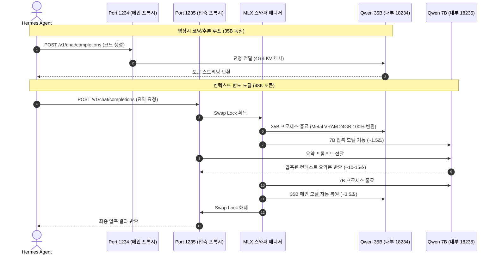
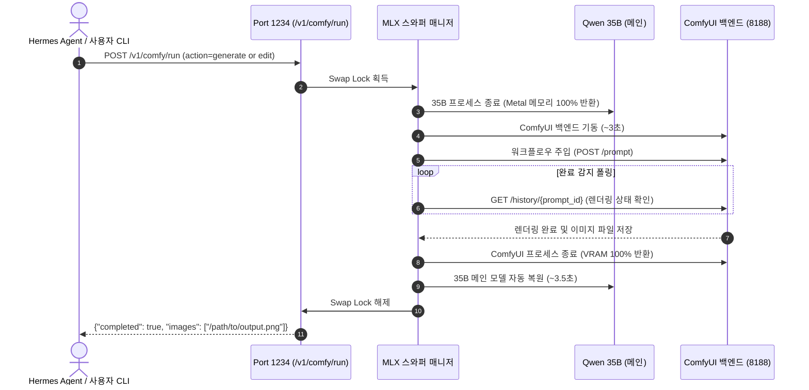

# MLX Dynamic Model Swapper (mlx-dynamic-swapper)

[한국어](#-소개) | [English Version](#-overview)

---

## 🇰🇷 한국어

### 💡 소개

> **Apple Silicon / Mac Studio (MLX & ComfyUI)를 위한 무중단 동적 메모리 스왑 프록시**  
> Mac M5 Max (36GB 통합 메모리) 환경에서 **대형 LLM (Qwen 35B)**, **컨텍스트 압축 모델 (Qwen 7B)**, 그리고 **고화질 이미지 생성/수정 엔진 (ComfyUI Qwen-Image 2.1)**을 메모리 초과(OOM) 없이 필요할 때만 교대로 실행하는 고성능 자동 스왑 시스템입니다.

---

### 🧐 왜 만들었는가?

Apple Silicon의 통합 메모리 구조(Unified Memory)는 강력하지만, 36GB 모델에서는 LLM과 이미지 생성 모델을 동시에 띄우는 것이 물리적으로 불가능합니다:

- **메인 코딩/사고 모델 (Qwen 35B 4-bit)**: 가중치 ~18GB + 프롬프트 캐시 ~4GB = **약 22~24GB 점유**
- **ComfyUI Qwen-Image 2.1 파이프라인**: 텍스트 인코더(8.9GB) + 디퓨전(6.9GB) + VAE = **약 18~20GB 점유**
- **동시 실행 시**: 24GB + 20GB = **44GB 이상 필요 ➔ 심각한 VRAM 부족, 시스템 스왑 폭증 및 커널 패닉/OOM 크래시 발생**

그러나 에이전트(Hermes Agent 등)의 실제 작업 흐름을 보면:
1. **코딩 LLM과 이미지 생성기가 같은 순간에 동시에 돌아갈 필요가 전혀 없습니다.**
2. 평소에는 메인 35B 모델이 36GB 메모리를 온전히 독점하여 초고속 코딩과 추론을 수행합니다.
3. 컨텍스트 압축이 필요할 때나, 사용자가 **"이미지 생성/수정"**을 요청할 때만:
   - 메인 모델 프로세스를 안전하게 종료하여 **Metal 메모리를 0.5초 만에 100% 반환**.
   - 목표 프로세스(압축 모델 or ComfyUI 백엔드)를 기동하여 작업을 수행.
   - 작업 완료 후 메모리를 비우고 **메인 모델을 원래 상태로 즉시 자동 복원**.

---

### 🔄 동작 아키텍처 (Architecture Flow)

#### 1. 컨텍스트 자동 압축 스왑 루프


#### 2. ComfyUI 온디맨드 이미지 생성/수정 스왑 루프


---

### ✨ 주요 기능

- **Metal 메모리 완벽 회수 (Zero Memory Leak)**: `os.killpg` 기반 프로세스 그룹 정리로 macOS Metal VRAM을 100% 깔끔하게 반환.
- **항시 대기 OpenAI 호환 엔드포인트**:
  - `http://127.0.0.1:1234/v1` (메인 모델 — Qwen3.6-35B-A3B-4bit, 도구 호출/스트리밍)
  - `http://127.0.0.1:1235/v1` (컨텍스트 압축 모델 — Qwen2.5-7B)
- **ComfyUI 온디맨드 동기식 실행 엔드포인트 (`/v1/comfy/run`)**:
  - 비동기 큐 기반인 ComfyUI의 단점을 극복하여, 요청 1번으로 **스왑 ➔ 워크플로우 주입 ➔ 렌더링 완료 감지 ➔ 복원 ➔ 결과 이미지 반환**을 단일 동기 HTTP 호출로 처리.
  - Text-to-Image 생성 (`t2i` / `generate`) 및 Image-to-Image 수정 (`edit` / `i2i`) 기본 템플릿 내장.
- **세션 수동 락/언락 API (`/v1/swap/lock`, `/v1/swap/unlock`)**:
  - 외부 스크립트가 세밀하게 ComfyUI와 상호작용할 수 있도록 메인 모델 일시 정지 및 복원 제어 지원.
- **초고속 스왑**: Apple Silicon 통합 메모리/NVMe 덕분에 7B 로딩 약 1.5초, ComfyUI 기동 약 3초, 35B 복원 약 3.5초 소요.
- **macOS LaunchAgent 백그라운드 상주**: 부팅 시 자동 시작 및 크래시 시 자동 복구.
- **간편한 통합 CLI (`mlx`, `comfy_swap.py`)**:
  - `mlx status`: 활성 모델, 실제 점유 메모리(RAM), PID, 프록시 상태 확인.
  - `mlx logs`: 실시간 스왑 및 추론 로그 스트리밍.
  - `comfy_swap.py generate`: 한 줄로 로컬 고화질 이미지 생성.
  - `comfy_swap.py edit`: 기존 이미지의 배경/스타일 수정.

---

### 🚀 설치 및 사용법 (Quick Start)

#### 1. 요구 사항
- Apple Silicon Mac (M1/M2/M3/M4/M5 Max/Ultra 권장, 36GB+ Unified Memory)
- Python 3.10 이상
- 필수 패키지: `mlx-lm`, `fastapi`, `uvicorn`, `httpx`

#### 2. 설치
```bash
git clone https://github.com/deokgoo/mlx-dynamic-swapper.git
cd mlx-dynamic-swapper
chmod +x install.sh bin/mlx bin/comfy_swap.py
./install.sh
```

#### 3. CLI 명령어

##### MLX 서비스 관리
```bash
# 실행 상태 및 활성 모델 확인
mlx status

# 실시간 스왑 로그 확인
mlx logs

# 데몬 재시작 및 중지
mlx restart
mlx stop
```

##### ComfyUI 이미지 생성 & 수정 CLI
```bash
# 1. 텍스트로 이미지 생성 (Text-to-Image)
python3 ~/.mlx-server/bin/comfy_swap.py generate \
  --prompt "A cute neon cybernetic cat sitting on a desk, 8k resolution, cinematic" \
  --steps 14

# 2. 기존 이미지 수정 (Image-to-Image / Edit)
python3 ~/.mlx-server/bin/comfy_swap.py edit \
  --image "/Users/deokgoo/ComfyUI-Shared/output/source.png" \
  --prompt "Make the background nighttime with stars and neon lights" \
  --steps 14
```

---

### ⚙️ 환경 설정 (Configuration)

`mlx_manager.py` 상단 환경 변수를 통해 경로와 포트를 커스텀할 수 있습니다:

| 환경 변수 | 기본값 | 설명 |
| :--- | :--- | :--- |
| `PYTHON_BIN` | `~/.mlx-server/bin/python` | `mlx_lm` 가상환경 Python 경로 |
| `MODEL_MAIN_PATH` | `~/.mlx-models/Qwen3.6-35B-A3B-4bit` | 메인 코딩/사고 모델 경로 (Port 1234) |
| `MODEL_COMPACT_PATH` | `~/.mlx-models/Qwen2.5-7B-Instruct-4bit` | 컨텍스트 압축 모델 경로 (Port 1235) |
| `PROXY_PORT_MAIN` | `1234` | 메인 모델 외부 OpenAI 프록시 포트 |
| `PROXY_PORT_COMPACT` | `1235` | 압축 모델 외부 OpenAI 프록시 포트 |
| `COMFY_PYTHON_BIN` | `~/ComfyUI-Installs/.../.venv/bin/python3` | ComfyUI 전용 Python 가상환경 |
| `COMFY_PORT` | `8188` | ComfyUI 내부 포트 |
| `COMFY_OUTPUT_DIR` | `~/ComfyUI-Shared/output` | 생성 이미지 저장 디렉터리 |
| `PROMPT_CACHE_BYTES` | `4GB` | 메인 모델용 KV 프롬프트 캐시 할당량 |

---

<br/>

## 🇺🇸 English Version

### 💡 Overview

> **Zero-OOM Dynamic Memory Swapper for Apple Silicon / Mac Studio (MLX & ComfyUI)**  
> Run a massive **35B coding/reasoning LLM**, a **7B compaction model**, and a full **ComfyUI Qwen-Image 2.1 pipeline** on a 36GB Mac Studio sequentially without out-of-memory (OOM) crashes.

---

### 💡 Why This Exists

On Apple Silicon Macs (such as Mac Studio M5 Max with 36GB Unified Memory), running large local LLMs alongside local diffusion models simultaneously exceeds physical limits:
- **Main Model (Qwen 35B 4-bit)**: ~18GB VRAM + ~4GB KV Cache = **~22-24GB**.
- **ComfyUI Qwen-Image 2.1**: Text Encoder (8.9GB) + UNet (6.9GB) + VAE = **~18-20GB**.
- **Combined concurrently**: 24GB + 20GB = **> 44GB** ➔ **Memory Pressure / Swapping / OOM crashes**.

In an agentic workflow:
1. **You never need the coding LLM and diffusion generator simultaneously at the exact same second.**
2. When an image generation or context summarization request arrives:
   - The swapper **unloads the 35B model** (`SIGTERM`), reclaiming **100% of Metal memory** in <0.5s.
   - Boots the target model/ComfyUI with all 36GB RAM available.
   - Upon completion, unloads the target and **seamlessly restores the 35B model**.

---

### 🛠 Features

- **Sequential Zero-Leak VRAM Management**: Automatically unloads processes using `os.killpg` to guarantee Metal unified memory is completely freed.
- **OpenAI-Compatible Endpoints**:
  - `http://127.0.0.1:1234/v1` (Main Model)
  - `http://127.0.0.1:1235/v1` (Compaction Model)
- **Synchronous ComfyUI On-Demand Endpoint (`/v1/comfy/run`)**:
  - Resolves ComfyUI's asynchronous queue limitation by polling `/history/{prompt_id}` until rendering is complete, then returning output image paths in a single HTTP response.
- **Command-line Helper (`comfy_swap.py`)**:
  - `comfy_swap.py generate --prompt "..."`
  - `comfy_swap.py edit --image "..." --prompt "..."`

---

## 📜 License

MIT License. Free to use, adapt, and build upon.
